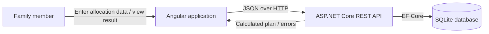
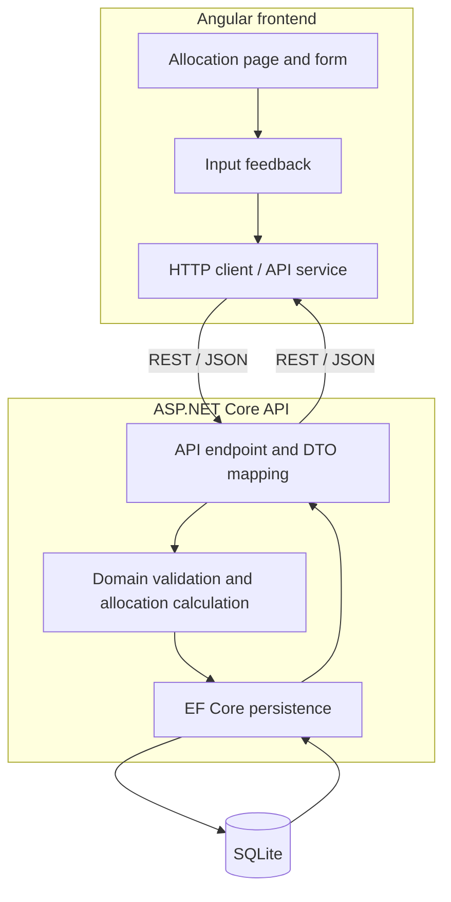
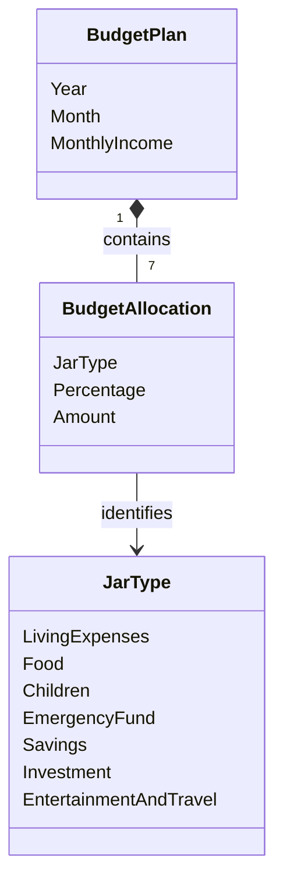
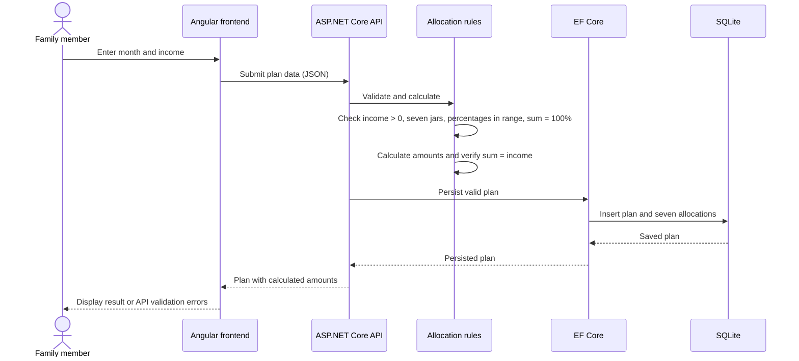

# Family Finance Management Architecture

## 1. Purpose and Source Status

This document describes the proposed MVP architecture for Monthly Income Allocation. It is based on the domain rules in `docs/knowledge/domain.md` and the approved requirement inventory at `docs/requirements/`.

**Source limitation:** `docs/requirements/monthly-income-allocation.md` is currently empty, while the feature-specific F1 and F2 requirements define the current seven-jar MVP. The available business rule identifiers are BR-001 through BR-009 in the domain document. Decisions below are mapped to those rules where possible. User workflows, editing behavior, API details, and financial precision beyond the stated formula are not approved here and must not be inferred as business requirements.

## 2. System Context

The MVP serves a family member who provides monthly income and receives calculated allocation amounts for the seven predefined jars. The Angular client communicates with one ASP.NET Core API. The API enforces the domain rules, calculates amounts, and persists budget plans in SQLite.

Authentication, multiple households/users, external integrations, and deployment topology are not defined by the available requirements and are outside this architecture's scope.

## 3. High-Level Architecture

Use a single deployable modular monolith on the backend and a separate Angular frontend:

Keep the backend in one ASP.NET Core application with clear endpoint, domain/business-rule, and persistence responsibilities. These are logical responsibilities, not separate services or a requirement for a layered framework. Use EF Core directly for persistence; add no repository framework unless a concrete need emerges.

## 4. Angular Frontend Responsibilities

- Present monthly income and the seven predefined jar types and rates (BR-002, BR-009).
- Provide immediate input feedback for income and percentage constraints, while treating the API as authoritative (BR-001, BR-003, BR-004).
- Send user-entered values to the API and render the returned calculated amounts; do not calculate authoritative amounts in the browser (BR-005, BR-006).
- Represent API validation and operational failures in the UI without replacing the server's rule decisions.

The exact page flow, whether existing plans can be edited, and the behavior after saving are pending requirements and UI specification.

## 5. ASP.NET Core Backend Responsibilities

- Expose the REST boundary and map JSON requests/responses to backend DTOs.
- Validate all business invariants independently of frontend validation (BR-001 through BR-004, BR-008).
- Use the canonical seven jar types when creating, reading, and persisting allocations (BR-002).
- Calculate allocation amounts on the server using the approved formula (BR-005, BR-006), then verify the total invariant (BR-007).
- Persist and retrieve plan data through EF Core and SQLite. Enforce monthly uniqueness in storage as well as application logic (BR-008).
- Return structured client errors for invalid requests and avoid exposing internal exception details.

Endpoint URLs, methods, DTO fields, and response codes belong in the API design/development specification and are not frozen by this high-level architecture.

## 6. SQLite Persistence

Use SQLite as the MVP's single relational store with EF Core. The minimum persistence concepts are:

- **BudgetPlan:** one monthly plan, keyed by its year and month, with monthly income and its allocations.
- **BudgetAllocation:** one percentage and backend-calculated amount for each predefined jar in a plan.
- **JarType:** a fixed domain enumeration/value set, not a user-managed lookup table: `LivingExpenses`, `Food`, `Children`, `EmergencyFund`, `Savings`, `Investment`, and `EntertainmentAndTravel` (BR-002).

Persist the seven allocations as children of their plan. Add a unique constraint on `(Year, Month)` to protect BR-008 from concurrent or repeated submissions. Enforce required fields and the plan/allocation relationship through the EF Core model and database constraints where SQLite supports them. The detailed columns, key representation, delete behavior, and migrations belong in the development specification.

## 7. Domain Model

The plan owns its seven allocations. A separate persisted `JarType` entity is unnecessary for a fixed set of seven types. The existing backend `BudgetPlan` model already has `Year`, `Month`, `MonthlyIncome`, `CreatedAt`, and `Allocations`; implementation should reconcile that model with this domain shape rather than introduce a parallel plan concept. Timestamp behavior and allocation model details require confirmation in the development specification.

## 8. API Boundaries

The API is the only boundary between Angular and persisted business data. It accepts user-provided period, income, and allocation percentages, and returns server-validated plan data including calculated amounts. The client must not submit amounts as trusted facts; if an amount is present in any future request contract, the server must ignore or reject it and recalculate (BR-005, BR-006).

Use JSON and REST over HTTP. Keep transport DTOs separate from EF Core entities so persistence changes do not silently change the public contract. The precise endpoints, DTO schema, status codes, and error envelope remain to be specified and frozen before parallel FE/BE implementation.

## 9. Monthly Income Allocation Data Flow

This flow describes the technical path implied by the domain rules, not an approved screen-by-screen workflow. The action for an already-existing month (reject, replace, or edit) is unresolved.

Before persistence, check the `(Year, Month)` uniqueness rule (BR-008); the database constraint remains the final guard against races. The exact behavior on duplicate month is not specified by the available requirements.

## 10. Validation Responsibilities

| Rule | Frontend | Backend | Persistence |
|---|---|---|---|
| Monthly income greater than zero (BR-001) | Immediate feedback | Required authoritative validation | Required/non-null; range enforcement in application |
| Exactly seven predefined jars (BR-002) | Render the fixed seven jar inputs | Require exactly one allocation per jar type | Parent-child relationship; detailed enforcement mechanism TBD |
| Each percentage from 0 through 100 (BR-003) | Immediate feedback | Authoritative per-allocation validation | Application validation |
| Percentages total exactly 100% (BR-004) | Helpful live total | Authoritative total validation | Application validation |
| One plan per year and month (BR-008) | May communicate duplicate response | Check before save and map uniqueness conflict | Unique constraint on `(Year, Month)` |

The frontend validation improves usability but can be bypassed; only backend validation determines whether a request is valid. Percentage precision and input bounds are not stated and must be specified before implementation.

## 11. Financial Calculation Responsibilities

The backend is authoritative for amounts (BR-005). Apply the domain formula (BR-006) to each jar:

`allocation amount = monthly income × allocation percentage / 100`

After calculating all allocations, verify `sum(allocation amounts) = monthly income` (BR-007). Use decimal arithmetic on the backend; do not use binary floating-point arithmetic for money or percentages. The frontend displays values returned by the API and does not recalculate them.

**Unresolved financial contract:** the requirements do not define allowed percentage precision, monetary input precision, rounding mode, or how any fractional-VND remainder is assigned. The formula and total invariant can conflict after rounding. Do not choose a rounding or remainder policy independently during implementation; obtain a product decision and record it in the development specification before freezing the calculation contract.

## 12. Error Handling

- Return field/rule validation errors for requests that violate BR-001 through BR-004 or the seven-jar requirement (BR-002); retain the same validation authority on every API path.
- Treat the unique `(Year, Month)` constraint violation as a domain conflict related to BR-008, not as an unhandled server failure. The user-visible duplicate-month behavior remains to be decided.
- Return a consistent JSON error shape from the API with a stable machine-readable code and safe message. Define the exact envelope and HTTP status mapping in the API specification.
- Log unexpected server/database exceptions on the backend; return a generic error to the client without stack traces, SQL, or sensitive internals.
- The Angular client distinguishes validation, conflict, and unexpected/network errors and preserves user-entered values when practical.

## 13. Important Architectural Decisions

| Decision | Rationale | Business traceability |
|---|---|---|
| One Angular client and one ASP.NET Core modular monolith | Fits a small internal one-day MVP and existing technology choices; avoids distributed-operation overhead. | Supports delivery of the monthly allocation capability in BR-001 through BR-009; no separate service is required by any rule. |
| Backend owns validation and all authoritative calculations | Client data is untrusted and allocation results must follow one consistent formula. | BR-001, BR-003 through BR-007. |
| Store a plan with seven child allocations and a fixed jar enum | Keeps the monthly plan and its complete allocation together without user-managed jar configuration. | BR-002, BR-008. |
| Enforce year/month uniqueness in SQLite as well as in backend logic | Application checks alone cannot prevent concurrent duplicate writes. | BR-008. |
| Use SQLite with EF Core; avoid a repository framework | The specified persistence stack is sufficient for a workshop MVP and simple relational data. | Supports durable monthly plans implied by BR-008; choice of technology is project-level, not a separate business requirement. |
| Keep exact API contract and financial rounding policy outside this document until approved | Prevents high-level architecture from inventing behavior not present in the requirements. | Required to implement BR-004, BR-006, and BR-007 consistently; current requirements omit precision/remainder decisions. |

## 14. Risks and Trade-offs

| Risk / trade-off | Effect | Mitigation / decision needed |
|---|---|---|
| Requirements file is empty | The workflow, duplicate-month behavior, API operations, and acceptance criteria cannot be confirmed. | Populate and approve the feature requirements before freezing detailed contracts. |
| Rounding and precision are undefined | Per-jar amounts may not sum exactly to income after rounding, contradicting BR-007. | Approve percentage precision, monetary precision, rounding, and remainder handling before implementation. |
| SQLite and decimal persistence details | SQLite has different numeric behavior from server databases; careless conversion can undermine exact financial invariants. | Keep calculation in .NET decimal, define a storage/serialization precision contract, and verify it in the development specification. |
| Duplicate-plan behavior is undefined | A unique constraint can prevent a second plan, but the user-facing action is unspecified. | Choose whether duplicate submission is rejected or an existing plan can be changed; do not infer replacement semantics. |
| Database constraints cannot express every cross-row rule simply | Exactly seven child rows and a percentage total are aggregate invariants. | Enforce these in one backend transaction/business operation; retain the database unique constraint for the month key. |
| Single SQLite database limits deployment/concurrency options | Suitable for a small MVP but not a commitment to multi-instance scale-out. | Keep deployment simple; revisit storage only if requirements establish a need beyond the workshop MVP. |

## 15. Requirement Traceability and Readiness

| Business rule | Architectural support |
|---|---|
| BR-001: Monthly income must be greater than 0 | Backend authoritative validation; frontend feedback (Sections 4, 5, 10). |
| BR-002: A monthly budget contains exactly seven predefined jars | Fixed `JarType` set and seven allocations per plan (Sections 5-7, 10). |
| BR-003: Allocation percentage is between 0 and 100 | Frontend feedback and backend validation (Sections 4, 5, 10). |
| BR-004: Sum of allocation percentages is exactly 100% | Backend aggregate validation; exact precision remains open (Sections 5, 10, 11). |
| BR-005: Backend calculates allocation amount | API/business logic owns the calculation (Sections 5, 8, 11). |
| BR-006: Amount = TotalIncome × Percentage / 100 | Backend calculation rule (Section 11). |
| BR-007: Sum of amounts equals TotalIncome | Post-calculation invariant; rounding policy is a blocker (Section 11). |
| BR-008: One plan per Year + Month | Plan persistence and unique database constraint (Sections 5, 6, 10). |
| BR-009: Currency is VND | VND values flow through API and persistence; precision contract remains open (Sections 4, 11). |

**Architecture status: NOT READY for implementation contract freeze.** The high-level component architecture now reflects the seven-jar MVP, but the approved source requirements are incomplete and calculation precision/remainder policy is unresolved. Backend and frontend can use this document for component responsibilities, but must not independently settle the missing business behavior. The API/DTO contract, duplicate-month behavior, detailed schema, and acceptance criteria must be approved in the feature requirements and development specification before parallel implementation is declared contract-frozen.
