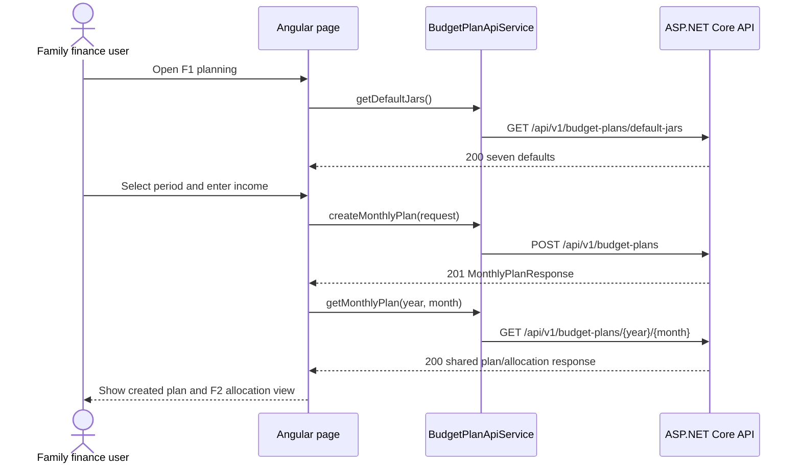

# F1 + F2 Monthly Planning and Income Allocation - Frontend Development Specification

## 1. Feature Overview

This document is the shared Angular contract for:

- **F1 - Monthly planning:** select a period, enter positive whole-VND income, review the seven fixed jar defaults, and create a plan.
- **F2 - Income allocation:** read the selected existing plan and display the backend-provided income allocation across the seven jars.

F1 owns the form and create action. F2 is read-only. Both use the same typed plan response from `GET /api/v1/budget-plans/{year}/{month}`. Editing rates, expenses, spent/remaining values, progress, and dashboard aggregation are out of scope.

**Source status:** F1 and F2 requirements are Draft/Proposed. The largest-remainder policy was approved on 2026-10-28; other unresolved requirement questions remain subject to product review.

## 2. Shared API Contract

The authoritative backend contract is [spec-f1-f2-backend.md](spec-f1-f2-backend.md). The frontend uses these operations:

| Operation | Method and URL | Feature |
|---|---|---|
| Load defaults | `GET /api/v1/budget-plans/default-jars` | F1 planning form |
| Create plan | `POST /api/v1/budget-plans` | F1 create action |
| Load plan/allocation | `GET /api/v1/budget-plans/{year}/{month}` | F1 post-create view and F2 allocation view |

There is no separate F2 `/allocation` endpoint. F2 consumes the same `MonthlyPlanResponse` returned when F1 reads a plan. The frontend never submits jar types, rates, or calculated budgets.

Money fields in the API and form model are digit-only strings representing whole VND. Keep them as strings and never convert them to JavaScript `number` values for financial calculations. The F1 income control may display period group separators, but it submits the ungrouped digit string.

## 3. Business Rules

| ID | Frontend behavior |
|---|---|
| F1-AC1 / BR-001 | Require a selected year/month and positive income. |
| F1-AC2 / F1-AC5 / BR-002 | Display exactly seven backend-provided, read-only jar defaults. |
| BR-004 | Display the fixed rates and total 100%; do not calculate or edit rates. |
| F1-AC3 | Keep the income model as positive ASCII digits; display period group separators without changing the model, and reject commas and other invalid characters. |
| BR-005 through BR-007 | Render only backend-provided budgets; do not calculate authoritative amounts in Angular. |
| F1-AC4 / BR-008 | Preserve input and show the API conflict on duplicate period. |
| F2-AC1 / F2-AC4 | Show each returned jar name, percentage, and budget. |
| F2-AC3 | On missing plan, show F1 navigation and no fabricated amounts. |
| BR-009 | Accept and format whole VND only. |

## 4. User Flows and Routes

### F1 planning

1. Open `/monthly-planning`.
2. Load the backend default-jar definition.
3. Select year/month and enter income.
4. Submit once; disable duplicate submission while pending.
5. On `201 Created`, navigate to `/monthly-plans/:year/:month`.
6. The destination loads the saved plan using the shared GET endpoint.

### F2 allocation

1. Open `/monthly-plans/:year/:month` or navigate there after F1 creation.
2. Angular validates route parameters and calls the shared GET endpoint.
3. Show a stable loading state while the request is pending.
4. On success, render income and seven backend budgets.
5. On `404`, explain that F1 must create the plan and provide a link back to `/monthly-planning`.
6. On failure or malformed data, show a safe retry state and never invent amounts.

The F2 page does not create or edit a plan.

## 5. Angular Models

```typescript
export type JarType =
  | 'livingExpenses'
  | 'food'
  | 'children'
  | 'emergencyFund'
  | 'savings'
  | 'investment'
  | 'entertainmentAndTravel';

export interface DefaultJar {
  jarType: JarType;
  name: string;
  percentage: number;
  suggestedLogic: string;
}

export interface DefaultJarsResponse {
  currency: 'VND';
  totalPercentage: 100;
  jars: DefaultJar[];
}

export interface CreateMonthlyPlanRequest {
  year: number;
  month: number;
  monthlyIncomeVnd: string;
}

export interface MonthlyPlanJar {
  jarType: JarType;
  name: string;
  percentage: number;
  budgetVnd: string;
}

export interface MonthlyPlanResponse {
  id: number;
  year: number;
  month: number;
  monthlyIncomeVnd: string;
  currency: 'VND';
  createdAtUtc: string;
  jars: MonthlyPlanJar[];
}

export interface ApiError {
  code: string;
  message: string;
  errors: Array<{
    field: string;
    code: string;
    message: string;
  }>;
}
```

## 6. Component and Service Responsibilities

| Component/service | Responsibility |
|---|---|
| `MonthlyPlanningPage` | F1 form, local validation, loading, submit, and error states |
| `IncomeAllocationPage` | F1 post-create/F2 route parsing, shared GET, retry, and page-level states |
| `DefaultJarList` | Render exactly seven read-only defaults and total 100% |
| `AllocationSummary` | Render period, monthly income, and seven returned allocations |
| `JarAllocationItem` | Render name, percentage, and formatted backend budget |
| `BudgetPlanApiService` | Own typed HTTP calls and error mapping |

No state-management framework is needed for this workflow. Do not hard-code a second frontend copy of rates or budgets.

## 7. API Service Contract

```typescript
getDefaultJars(): Observable<DefaultJarsResponse>
createMonthlyPlan(request: CreateMonthlyPlanRequest): Observable<MonthlyPlanResponse>
getMonthlyPlan(year: number, month: number): Observable<MonthlyPlanResponse>
```

Expected outcomes:

- Defaults: `200 DefaultJarsResponse`; retryable service error otherwise.
- Create: `201 MonthlyPlanResponse`, `400 VALIDATION_ERROR`, or `409 MONTHLY_PLAN_ALREADY_EXISTS`.
- Read: `200 MonthlyPlanResponse`, `400 VALIDATION_ERROR`, `404 MONTHLY_PLAN_NOT_FOUND`, or `500 INTERNAL_ERROR`.

Do not retry POST automatically after a timeout. A plan may have been created; a later retry should surface the API uniqueness response. A GET may have one user-triggered retry for the MVP.

## 8. Forms and Validation

| Control | Model | Validation |
|---|---|---|
| Period | `{ year: number \| null, month: number \| null }` | Required; year 1-9999; month 1-12 |
| Income | Canonical digit string | Required; digits only; positive integer; no sign, decimal, or fraction; display periods as group separators |
| Defaults | `DefaultJarsResponse` | Seven known unique jars; integer rates total 100%; `currency === 'VND'` |

The F1 income field accepts a canonical ASCII digit string and displays groups of three digits with periods (for example, `1000` displays as `1.000`). Periods are display separators only; the form and API retain `1000`. Commas, signs, decimals, and other invalid characters remain invalid and are not silently removed. The month control defaults to the current month and remains editable.

For responses, perform a shape check before rendering: `currency` must be `VND`, there must be exactly seven known unique jar types, percentages must be integer values totaling 100%, and all money values must be digit-only strings. Do not independently replace backend arithmetic with a client calculation.

## 9. Visual and Display Contract

The F2 visual baseline is [f2-income-allocation.html](../requirements/f2-income-allocation/f2-income-allocation.html). Do not treat its static sample values as runtime data. Angular binds the API response.

| Reference element | Angular behavior | Data source |
|---|---|---|
| Back link | Navigate to `/monthly-planning` | UI navigation |
| `Month Budget Summary` heading | Identify the selected period | Route/response year and month |
| Selected period | Load the year/month encoded in `/monthly-plans/:year/:month` through the shared GET endpoint | Route/API path |
| Total-income summary | Format `monthlyIncomeVnd` as VND | Response |
| `100% allocated` donut | Visualize the fixed seven rates; no client financial calculation | `jars[].percentage` |
| Seven-item legend | Render seven canonical names/rates | `jars` |
| Seven jar cards | Render name, percentage, and backend budget | `jars[]` |
| Meter bars | Optional percentage-share accent only; never bind spent/progress data | `percentage` |
| Responsive grid | Preserve readable cards and long names on narrow screens | UI layout |

The visual reference includes a month selector, but F2 currently has no API to list saved plans. Plan-history browsing and its selector are deferred; the implemented page displays the route period only.

F1's planning screen uses the same default-jar data but does not need to show allocated amounts before creation. F1's created-plan view and F2 may show backend `budgetVnd` because they use the shared read response. No `spent`, `remaining`, expense, or progress models may be added for these features.

For F1 desktop layout, place **Plan details** and **Your default allocation** in a two-column grid with their panel tops aligned. The content width is capped at 1148px with a 48px horizontal inset; the form column is capped at 459px with a 19px column gap, and the allocation column fills the remainder. Stack the panels at 920px and narrower. The shared shell uses a centered 1440px maximum width, a 176px expanded sidebar, 12px icon-and-text navigation labels, slate inactive text, and blue active text. The allocation panel uses a **Fixed allocation** eyebrow above its title.

## 10. Loading, Empty, Error, and Success States

- **F1 initial loading:** show a stable loading state for defaults and disable create until loaded.
- **F1 ready:** show seven defaults, total 100%, period controls, income input, and create action.
- **F1 invalid:** show field-level messages and retain entered values.
- **F1 submitting:** disable repeated submission and retain values.
- **F1 duplicate:** show the API conflict message without edit/replace behavior.
- **F1 created:** navigate to the shared plan route and load it from the API.
- **F2 loading:** show stable skeleton/text state without zero placeholders.
- **F2 success:** show income and seven allocations in canonical response order.
- **F2 missing plan:** show `MONTHLY_PLAN_NOT_FOUND` guidance and F1 link; do not show defaults or zero budgets.
- **Network/500:** show a generic message and retry action without raw server details.
- **Malformed response:** show a data-integrity error and do not render partial amounts.

## 11. Accessibility and Interaction

- Associate every label with its control and identify required fields in text.
- Make period controls, income entry, create, retry, and back actions keyboard-operable.
- Announce loading, validation, errors, and success with an appropriate live region.
- Do not communicate state or validity through color alone.
- Focus the first invalid F1 control after failed submission.
- Use a heading and landmark for the allocation view and a semantic list/table for jar values.
- Prevent overlap for long jar names and VND values on narrow screens.

## 12. FE/BE Field Mapping

| UI field | Angular model | JSON | Backend/domain |
|---|---|---|---|
| Selected period | `year`, `month` | Request or path `year`, `month` | `BudgetPlan.Year/Month` |
| Monthly income | `monthlyIncomeVnd: string` | `monthlyIncomeVnd` | `BudgetPlan.MonthlyIncomeVnd` |
| Default jar name/rate | `DefaultJar[]` | `jars[].name/percentage` | Canonical backend definition |
| Jar identifier | `JarType` | `jarType` | `BudgetAllocation.JarType` |
| Jar budget | `budgetVnd: string` | `budgetVnd` | Backend-calculated `BudgetAllocation.BudgetVnd` |
| Created plan metadata | `id`, `createdAtUtc` | Same | Database/backend generated |
| Currency | literal `VND` | `currency` | Backend constant |

## 13. UI/API Interaction



## 14. Frontend Tasks

- [x] Add the shared TypeScript models and typed API service.
- [x] Build the F1 planning form and read-only default-jar list.
- [x] Implement whole-VND string handling and accessible validation.
- [x] Implement create pending, duplicate, uncertain-network, and validation states.
- [x] Add the shared plan route with year/month parsing and loading, retry, and not-found handling.
- [x] Render F1 post-create income and jar budgets using backend values only.
- [x] Complete F2's HTML reference mapping, including its responsive allocation visualization, donut/legend, and percentage-share accents without adding spending-progress data.

## 15. Parallel Development and Traceability

Frontend can use the DTOs and examples in [spec-f1-f2-backend.md](spec-f1-f2-backend.md) as mocks while backend implementation proceeds. Backend and frontend must update this shared pair of specifications together if an endpoint, field, enum, error, money representation, or calculation rule changes.

| Requirement | Frontend implementation |
|---|---|
| F1 create monthly plan | Period/income form, validation, create request, duplicate handling |
| F1 seven default jars | Backend-loaded read-only defaults and total 100% |
| F1 post-create view | Navigate and load shared plan response |
| F2 display seven allocations | Render names, rates, and backend budgets |
| F2 missing plan | 404 empty state with F1 navigation |
| F2 plan browsing | Deferred; there is no list endpoint or month selector in the route-based view |
| BR-005 through BR-007 | No client financial calculation; backend values only |
| BR-009 | Whole-VND digit strings and VND formatting |
| F1/F2 out of scope | No rate editing, expense, spent, remaining, or progress UI |

## 16. Readiness

- **Frontend specification:** F1 and the route-based F2 allocation view are implemented; plan-history browsing is deferred.
- **API contract:** Shared F1/F2 read contract; the largest-remainder policy is approved.
- **F1/F2 contract:** SHARED through the common plan GET response.
- **Blocking issues:** None for the route-based F2 view. Plan-history browsing remains deferred.
