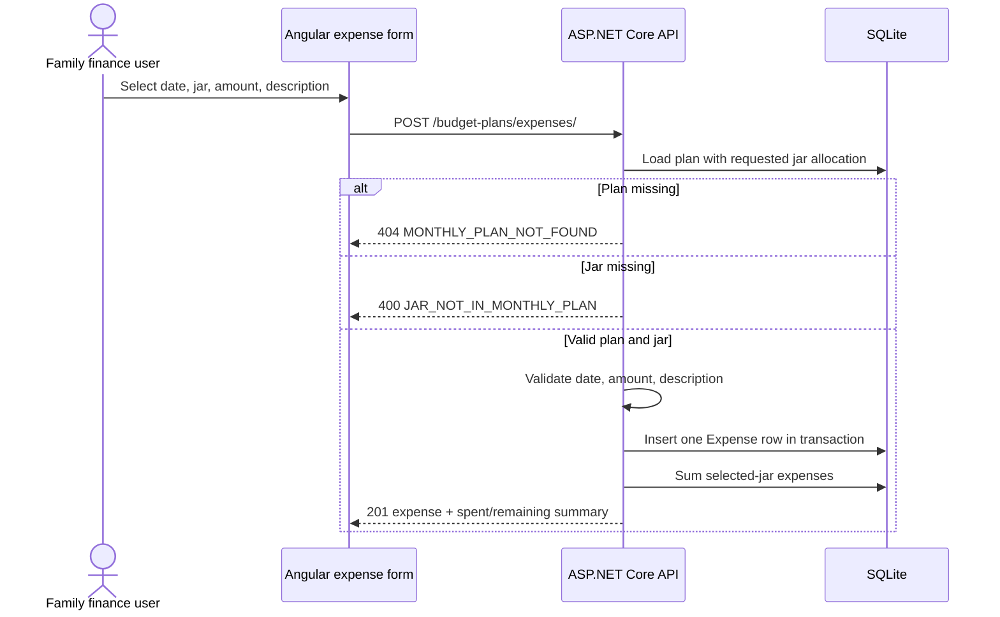

# F3 Add and Assign an Expense - Backend Development Specification

## 1. Feature Overview

F3 creates one expense in an existing monthly plan and assigns it to exactly one of that plan's seven jars. The backend validates the plan, jar membership, date, amount, and description, persists the expense, and returns the saved expense with recalculated spending totals for the selected jar.

**Story:** F3-US-01 - Add an expense to a jar in a monthly plan  
**Dependency:** F1 + F2 monthly planning and allocation  
**Status:** Draft; the contract is implementation-ready for the defined create-expense slice.

### Scope

In scope:

- Create exactly one expense per request.
- Select an existing monthly plan by year/month.
- Assign the expense to one existing jar in that plan.
- Store whole-VND amount, ISO calendar date, and description.
- Calculate selected-jar spent and remaining values on the backend.

Out of scope:

- Editing or deleting expenses, covered by F4.
- Split or recurring expenses, attachments, categories beyond the selected jar, authentication, and detailed dashboard layout.
- An overdraft or overspending restriction. Expenses may exceed the jar budget; `remainingVnd` may be negative.

## 2. Source Alignment and Decisions

This specification follows:

- [F3 requirements](../requirements/f3-add-expenses/f3-add-expenses.md)
- [domain rules](../knowledge/domain.md)
- [architecture](architecture.md)
- the visual reference [f3-add-expenses.html](../requirements/f3-add-expenses/f3-add-expenses.html)

The HTML is a visual reference only. Its sample date, Food selection, and `1,250,000` amount are not seeded data or API defaults. The UI labels map to `expenseDate`, `jarType`, `amountVnd`, and `description` in the request contract.

Technical decisions needed for deterministic implementation:

- `expenseDate` is a date-only value serialized as `YYYY-MM-DD`; no timezone conversion is applied.
- Descriptions are trimmed before validation and storage, must contain at least one non-whitespace character, and have a maximum length of 500 Unicode characters.
- `amountVnd` is an ungrouped ASCII digit string representing a positive signed 64-bit integer.
- Spent and remaining are derived values, not stored columns. This prevents stale totals when F4 later edits or deletes expenses.
- The selected plan is derived from `expenseDate`; the backend finds the plan whose year/month matches the date and resolves `jarType` only within that plan.

## 3. Business Rules and Invariants

| ID | Rule | Backend enforcement |
|---|---|---|
| F3-AC1 / BR-010 | An expense is assigned to one jar belonging to the requested plan. | Load the plan's allocation by canonical `jarType`; reject missing membership. |
| F3-AC2 / BR-012 | Spent equals the sum of saved expenses assigned to the jar. | Query `SUM(AmountVnd)` after save; do not trust client totals. |
| F3-AC2 / BR-013 | Remaining equals jar budget minus spent. | Calculate `BudgetVnd - SpentVnd` on the server. |
| F3-AC3 / BR-010 | Amount must be positive. | Reject missing, malformed, zero, negative, decimal, signed, or grouped values. |
| F3-AC4 / BR-011 | Date, jar, and non-empty description are required. | Validate all request fields before insertion. |
| F3-AC5 | Plan must exist and jar must belong to that plan. | Derive the plan from the expense date and return plan-not-found or jar-not-in-plan; never substitute another month. |
| F3-AC6 | Expense date identifies the selected plan month. | Parse the date and use its year/month to load the plan. |
| BR-009 | Money uses whole VND. | Store `long`/SQLite `INTEGER`; return digit-only JSON strings. |
| F3 scope | One expense is saved per request. | One `POST` creates one `Expense` row. |

No spending-cap validation is applied. A successful expense can produce a negative remaining amount.

## 4. Domain Model

```text
BudgetPlan 1 ---- 7 BudgetAllocation
BudgetAllocation 1 ---- many Expense

Expense
  Id: int
  BudgetAllocationId: int
  ExpenseDate: DateOnly
  AmountVnd: long
  Description: string
  CreatedAtUtc: DateTime
```

The expense points to `BudgetAllocation`, which indirectly identifies its `BudgetPlan`. Do not duplicate `BudgetPlanId` on `Expense`; resolving the allocation through the requested plan prevents cross-month jar assignment.

`SpentVnd` and `RemainingVnd` are response calculations:

```text
spentVnd = SUM(expenses.amountVnd for selected allocation)
remainingVnd = selectedAllocation.budgetVnd - spentVnd
```

## 5. Database Design

Add one table through an EF Core migration. F3 does not change the existing `BudgetPlans` or `BudgetAllocations` columns.

### `Expenses`

| Column | SQLite type | Null | Constraint / meaning |
|---|---|---|---|
| `Id` | `INTEGER` | No | Primary key, autoincrement |
| `BudgetAllocationId` | `INTEGER` | No | FK to `BudgetAllocations.Id`, cascade delete |
| `ExpenseDate` | `TEXT` | No | ISO date `YYYY-MM-DD`, date-only |
| `AmountVnd` | `INTEGER` | No | Positive whole VND; `CHECK (AmountVnd > 0)` |
| `Description` | `TEXT` | No | Trimmed, 1-500 characters |
| `CreatedAtUtc` | `TEXT` | No | Backend-generated UTC timestamp |

Indexes and constraints:

- Primary key on `Id`.
- Foreign key `BudgetAllocationId` to `BudgetAllocations(Id)` with `ON DELETE CASCADE`.
- Index on `(BudgetAllocationId, ExpenseDate)` for spent-total queries and future F4 date operations.
- `CHECK (AmountVnd > 0)`.
- `Description` is non-null; application validation enforces trimmed non-empty and maximum length.
- Do not store `SpentVnd` or `RemainingVnd`; they are derived from the expense rows and allocation budget.

EF model guidance:

- Add `DbSet<Expense> Expenses`.
- Add `ICollection<Expense> Expenses` to `BudgetAllocation` and a required relationship.
- Map `DateOnly` to SQLite `TEXT` using an explicit `ValueConverter<DateOnly, string>` with invariant `yyyy-MM-dd` formatting, or use an equivalent explicit string-backed persistence property. Do not persist a timezone-bearing `DateTime` for the expense date.
- Keep `AmountVnd` as C# `long` and SQLite `INTEGER`.

## 6. API Contract

Base path: `/api/v1/budget-plans`. JSON names are camelCase. This feature adds one endpoint.

### API-F3-01 - Create expense

**Method:** `POST`  
**URL:** `/api/v1/budget-plans/expenses/`  
**Purpose:** Create one expense for a jar in the monthly plan identified by the expense date and return the updated selected-jar spending totals.  
**Path parameters:** none.  
**Query parameters:** none.  
**Request body:** `CreateExpenseRequest`.

#### Request DTO

| JSON property | Type | Required | Validation |
|---|---|---|---|
| `expenseDate` | string | Yes | ISO calendar date `YYYY-MM-DD`; its year/month identifies the monthly plan to use. |
| `jarType` | string enum | Yes | One of the seven stable values and must belong to the requested plan. |
| `amountVnd` | string | Yes | ASCII digits only; positive `Int64`; no sign, decimal, whitespace, or grouping separator. |
| `description` | string | Yes | Trimmed non-empty text, maximum 500 Unicode characters. |

Example request:

```json
{
  "expenseDate": "2026-09-26",
  "jarType": "food",
  "amountVnd": "1250000",
  "description": "Weekly groceries"
}
```

The client must not send `budgetVnd`, `spentVnd`, `remainingVnd`, `budgetAllocationId`, or `budgetPlanId`.

#### Success response: `201 Created`

The `Location` header is `/api/v1/budget-plans/expenses/{expenseId}`. The response contains the saved expense and the recalculated selected-jar summary.

```json
{
  "expense": {
    "id": 41,
    "expenseDate": "2026-09-26",
    "jarType": "food",
    "jarName": "Food",
    "amountVnd": "1250000",
    "description": "Weekly groceries",
    "createdAtUtc": "2026-09-26T12:00:00Z"
  },
  "jarSummary": {
    "jarType": "food",
    "jarName": "Food",
    "percentage": 20,
    "budgetVnd": "6000000",
    "spentVnd": "1250000",
    "remainingVnd": "4750000"
  }
}
```

`remainingVnd` is a signed digit string: non-negative values use digits only; negative values use a leading ASCII `-` followed by digits. This is the only signed money response in F3 because overspending is allowed by scope.

#### Error responses

| HTTP | Code | Condition |
|---:|---|---|
| 400 | `VALIDATION_ERROR` | One or more malformed/missing request fields |
| 400 | `JAR_NOT_IN_MONTHLY_PLAN` | `jarType` is valid but the requested plan does not contain that jar |
| 404 | `MONTHLY_PLAN_NOT_FOUND` | No plan exists for the requested year/month |
| 500 | `INTERNAL_ERROR` | Unexpected persistence or calculation failure |

Validation example:

```json
{
  "code": "VALIDATION_ERROR",
  "message": "One or more fields are invalid.",
  "errors": [
    { "field": "amountVnd", "code": "MUST_BE_POSITIVE", "message": "Expense amount must be greater than zero." },
    { "field": "description", "code": "REQUIRED", "message": "Description is required." }
  ]
}
```

No expense row is committed when validation, plan lookup, jar lookup, or total calculation fails.

## 7. Create and Calculation Flow



Implementation sequence:

1. Parse and validate the request shape without converting money through floating point.
2. Parse `expenseDate`, derive its year/month, and load that monthly plan with the allocation matching `jarType`.
4. Return `404` if the plan is absent; return `400 JAR_NOT_IN_MONTHLY_PLAN` if the allocation is absent.
5. Validate amount/description and use the parsed date as the plan-period key.
6. Insert one expense and save atomically.
7. Calculate `spentVnd` from all expenses for the allocation and `remainingVnd = BudgetVnd - spentVnd`.
8. Return `201` only after the row and calculated invariant are successfully persisted/read.

Use a transaction around insert and summary calculation if the implementation uses separate database operations. At minimum, use one `SaveChangesAsync` for the insert and calculate totals from committed data. F4 must reuse the same summary calculation service.

## 8. Backend Implementation Boundaries

- Keep the existing ASP.NET Core modular monolith, EF Core, and SQLite stack.
- Reuse `BudgetPlan`, `BudgetAllocation`, `JarType`, and the canonical jar catalog from F1/F2.
- Add `Expense` as the only new persisted entity for F3.
- Keep transport DTOs separate from EF entities.
- Do not trust client-supplied plan IDs, allocation IDs, budgets, spent totals, or remaining totals.
- Do not reject overspending because F3 requirements leave that behavior unrestricted.
- Do not implement F4 edit/delete or F5 dashboard APIs in this feature.

## 9. Migration and Sample Data Commands

Run from `backend/FamilyFinance.Api` after adding the model and `ApplicationDbContext` mapping:

```powershell
dotnet restore
dotnet tool install --global dotnet-ef --version 8.0.20 # one-time, if needed
dotnet ef migrations add F3AddExpenses
dotnet ef database update
dotnet run --urls http://localhost:5000
```

Do not delete `family-finance.db` or regenerate the initial/F1 migrations. The application startup already calls `Database.Migrate()`; review the generated migration before applying it.

Create a sample expense through the API, not direct SQL:

```powershell
$body = @{
  expenseDate = "2026-09-26"
  jarType = "food"
  amountVnd = "1250000"
  description = "Weekly groceries"
} | ConvertTo-Json

Invoke-RestMethod -Method Post `
  -Uri "http://localhost:5000/api/v1/budget-plans/expenses/" `
  -ContentType "application/json" `
  -Body $body
```

The selected plan must already exist. Choose a period with a valid F1 plan; otherwise the expected result is `404 MONTHLY_PLAN_NOT_FOUND`.

## 10. FE/BE Field Mapping

| UI field | Angular model | JSON property | Backend/domain | Database |
|---|---|---|---|---|
| Expense date | `expenseDate: string` (`YYYY-MM-DD`) | `expenseDate` | `DateOnly` | `Expenses.ExpenseDate` TEXT |
| Jar selector | `jarType: JarType` | `jarType` | Plan allocation lookup | `BudgetAllocations.JarType` |
| Amount | canonical digit string | `amountVnd` | parsed positive `long` | `Expenses.AmountVnd` INTEGER |
| Description | trimmed string | `description` | validated string | `Expenses.Description` TEXT |
| Saved expense ID | `id: number` | response only | database generated | `Expenses.Id` |
| Spent total | `spentVnd: string` | response only | `SUM(Expenses.AmountVnd)` | Derived |
| Remaining total | `remainingVnd: string` | response only | `BudgetAllocation.BudgetVnd - spentVnd` | Derived |
| Created timestamp | `createdAtUtc: string` | response only | backend generated | `Expenses.CreatedAtUtc` TEXT |

## 11. Definition of Done and Traceability

F3 backend is complete when API-F3-01 creates one expense only for an existing plan and member jar, rejects invalid amount/date/jar/description cases with the defined errors, stores whole-VND data, returns the saved expense, calculates selected-jar spent and remaining values on the backend, permits overspending without silently substituting another jar, and leaves F1/F2/F4/F5 behavior unchanged.

| Requirement | Backend implementation |
|---|---|
| F3-AC1 | Resolve `jarType` within the requested plan. |
| F3-AC2 | Persist expense and return backend-calculated `spentVnd`/`remainingVnd`. |
| F3-AC3 | Positive digit-string amount validation. |
| F3-AC4 | Required date, jar, and trimmed description validation. |
| F3-AC5 | Date-derived plan lookup and jar membership validation; no cross-month substitution. |
| F3-AC6 | Date-only year/month determines the plan. |
| BR-009 | Whole-VND `long`/SQLite `INTEGER`; digit-string JSON amounts. |
| BR-012 / BR-013 | Derived aggregate formulas. |

**Backend specification:** READY for implementation design.  
**API contract:** READY for F3 create implementation; future F4/F5 response extensions must preserve these fields.  
**Blocking issues:** 0 for the defined F3 create scope.
