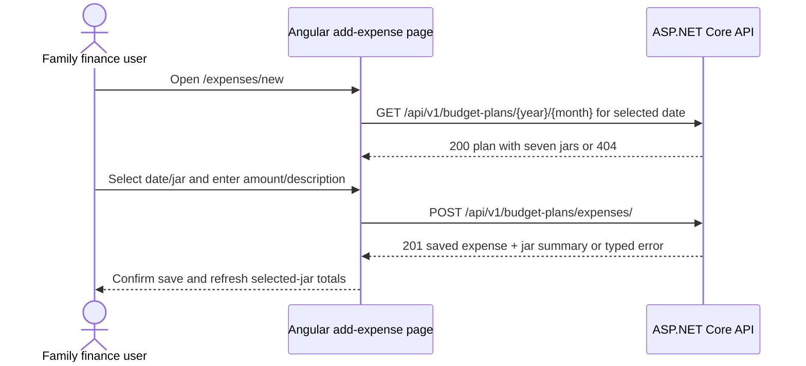

# F3 Add and Assign an Expense - Frontend Development Specification

## 1. Feature Overview

Build an Angular expense-entry workflow for one existing monthly plan. The user selects an expense date and jar, enters a positive whole-VND amount and description, then saves one expense through the backend.

**Story:** F3-US-01 - Add an expense to a jar in a monthly plan  
**Dependency:** F1 + F2 monthly planning and allocation  
**Source status:** Draft; this specification defines the implementation contract for the F3 create flow.

F3 is limited to creating one expense. Editing/deleting expenses, recurring or split expenses, attachments, categories beyond jar, overspending restrictions, and detailed dashboard/progress UI are out of scope.

## 2. Source Alignment and Visual Reference

The authoritative backend contract is [spec-f3-backend.md](spec-f3-backend.md). This specification follows [F3 requirements](../requirements/f3-add-expenses/f3-add-expenses.md), [domain rules](../knowledge/domain.md), and [architecture](architecture.md).

The visual reference is [f3-add-expenses.html](../requirements/f3-add-expenses/f3-add-expenses.html). It shows:

- a page titled **Add an expense**;
- an **Expense details** form with date, jar, amount, description, and **Save expense** action;
- a right-side **Selected jar** summary with the jar name and rate;
- a confirmation note that jar spending totals refresh after save;
- a breadcrumb/back context for expenses.

The HTML's `26 September 2026`, `Food`, `20%`, `1,250,000`, and placeholder description are illustrative mockup values. Runtime Angular state must come from the route, the existing plan response, and the user's input.

## 3. Route and User Flow

Recommended route:

`/expenses/new`

1. Initialize the expense date control, using the current date only if that UI default is approved.
2. Load the existing monthly plan for the selected expense date through `GET /api/v1/budget-plans/{year}/{month}` when populating the jar selector.
3. If the plan is missing, show a required-plan state and link to monthly planning; do not offer jars from another month.
4. Populate the jar selector from the plan's seven returned jars. Preserve the backend canonical order.
5. Let the user select a date, one jar, a positive whole-VND amount, and a non-empty description.
6. On submit, disable duplicate submission and call the single F3 create endpoint. The API derives the plan month from `expenseDate`; the create request has no year/month fields.
7. On success, show confirmation, update the selected jar's displayed spent/remaining summary from the response, and provide navigation back to the monthly plan/expenses context.
8. On validation or failure, preserve entered fields and show the relevant error.

The route may optionally receive `jarType` and `expenseDate` query parameters from a dashboard/card entry point. If present and valid for the loaded plan, preselect them; the create request remains governed by the shared API contract. A missing/invalid query value must not select a jar from another plan.

## 4. Angular Models

```typescript
export type JarType =
  | 'livingExpenses'
  | 'food'
  | 'children'
  | 'emergencyFund'
  | 'savings'
  | 'investment'
  | 'entertainmentAndTravel';

export interface MonthlyPlanJar {
  jarType: JarType;
  name: string;
  percentage: number;
  budgetVnd: string;
}

export interface MonthlyPlanResponse {
  id: number;
  year: number;
  month: number;
  monthlyIncomeVnd: string;
  currency: 'VND';
  createdAtUtc: string;
  jars: MonthlyPlanJar[];
}

export interface CreateExpenseRequest {
  expenseDate: string;
  jarType: JarType;
  amountVnd: string;
  description: string;
}

export interface CreatedExpense {
  id: number;
  expenseDate: string;
  jarType: JarType;
  jarName: string;
  amountVnd: string;
  description: string;
  createdAtUtc: string;
}

export interface JarSpendingSummary {
  jarType: JarType;
  jarName: string;
  percentage: number;
  budgetVnd: string;
  spentVnd: string;
  remainingVnd: string;
}

export interface CreateExpenseResponse {
  expense: CreatedExpense;
  jarSummary: JarSpendingSummary;
}

export interface ApiError {
  code: string;
  message: string;
  errors: Array<{
    field: string;
    code: string;
    message: string;
  }>;
}
```

Money values remain strings. `remainingVnd` can be negative when spending exceeds the budget; do not parse it through JavaScript floating-point arithmetic.

## 5. Component and Service Responsibilities

| Component/service | Responsibility |
|---|---|
| `AddExpensePage` | Route parsing, plan loading, form state, submit, and page-level states |
| `ExpenseDetailsForm` | Date, jar, amount, description controls and client validation |
| `SelectedJarSummary` | Show selected jar name/rate and post-save spending totals |
| `BudgetPlanApiService` | Load the plan and create one expense through typed HTTP calls |
| `MoneyFormatter` | Display digit-string VND values without changing wire values |

No new state-management framework is needed. Do not calculate budget, spent, or remaining in Angular.

## 6. API Service Contract

```typescript
getMonthlyPlan(year: number, month: number): Observable<MonthlyPlanResponse>
createExpense(
  request: CreateExpenseRequest
): Observable<CreateExpenseResponse>
```

HTTP calls:

```text
GET  /api/v1/budget-plans/{year}/{month}
POST /api/v1/budget-plans/expenses/
```

The create request sends only the four UI-defined fields: `expenseDate`, `jarType`, `amountVnd`, and `description`. The API derives the plan year/month from `expenseDate`; do not send year/month path parameters, plan IDs, allocation IDs, budget, spent, or remaining values.

Expected create outcomes:

| Status | Frontend behavior |
|---:|---|
| 201 | Show confirmation and apply the returned expense/jar summary. |
| 400 `VALIDATION_ERROR` | Map `errors[].field` to controls; preserve all inputs. |
| 400 `JAR_NOT_IN_MONTHLY_PLAN` | Show a jar-selection error; reload the plan before retrying. |
| 404 `MONTHLY_PLAN_NOT_FOUND` | Show required-plan state and navigate to F1. |
| 500 `INTERNAL_ERROR` or network failure | Show a safe retry message; do not expose raw server details. |

Do not automatically retry the POST because the server may have saved the expense before a network failure. A user retry may receive a new expense unless the user confirms the previous result; this is an MVP limitation to document in UI behavior.

## 7. Form and Validation Contract

| Control | Angular value | Required | Client validation |
|---|---|---|---|
| Expense date | `YYYY-MM-DD` string | Yes | Valid calendar date; its year/month determines the plan used by the create API |
| Jar | `JarType \| null` | Yes | One of the seven loaded plan jars |
| Amount | canonical digit string | Yes | ASCII digits only, positive integer, no sign/decimal/grouping in request value |
| Description | string | Yes | Trimmed non-empty; maximum 500 characters |

The visible amount input may show VND grouping, but the form must normalize to ungrouped ASCII digits before the request. Never convert to a JavaScript `number` for financial calculations. Trim description on submit and preserve the user's field values when showing errors.

The frontend may validate the plan response shape before populating the jar selector: `currency === 'VND'`, exactly seven unique known jars, integer rates totaling 100%, and digit-only non-negative `budgetVnd`. If invalid, show a data-integrity error and do not submit.

## 8. Visual and Interaction Contract

Implement the structure shown in [f3-add-expenses.html](../requirements/f3-add-expenses/f3-add-expenses.html):

| Visual element | Angular behavior |
|---|---|
| Top context/header | Identify the Expenses area and current user context if the existing shell provides it; do not add authentication behavior. |
| Breadcrumb/back context | Navigate back to the monthly plan or expenses context. |
| `Add an expense` heading and supporting text | Static page content. |
| `Expense details` panel | Host the date, jar, amount, description, and save controls. |
| Expense date | Native/accessibly labeled date control; the selected date determines which monthly plan is used. |
| Jar selector | Select only from the loaded plan's seven jars; show name and percentage. |
| Amount | Whole-VND input with `VND` suffix and positive-amount hint. |
| Description | Required text input/textarea with example placeholder. |
| `Save expense` | Submit one expense; show pending state and prevent duplicate clicks. |
| `Selected jar` panel | Show selected name/rate before save; after save show returned spent/remaining values. |
| Success note | Confirm save and explain that totals have refreshed from the backend. |

The layout must remain usable on narrow screens: stack the form and selected-jar panel, keep labels and long jar names readable, and prevent VND values from overlapping controls. The mockup's fixed desktop dimensions are not a runtime sizing contract.

## 9. Loading, Success, Empty, and Error States

- **Loading plan:** show a stable loading state and disable form submission.
- **Plan missing:** show `Create a monthly plan before adding an expense` and a link to `/monthly-planning`; no jar selector from another month.
- **Plan loaded:** show the form with the seven available jars.
- **Initial form:** require date, jar, amount, and description; do not submit incomplete data.
- **Submitting:** disable save, preserve inputs, and indicate progress.
- **Created:** show success confirmation, clear or retain the form according to the page convention, and render the returned selected-jar totals.
- **Validation error:** show field-level messages and keep all entered values.
- **Date/plan month:** the expense date determines the plan month; there is no separately selected month against which the date must be checked.
- **Jar membership error:** reload the plan and require a valid current jar selection.
- **Network/server error:** show a generic retry message without fabricated totals.
- **Overspent jar:** display negative remaining as a valid backend result; do not block save or replace it with zero.

## 10. Accessibility

- Associate visible labels with date, jar, amount, and description controls.
- Mark required fields in text and expose validation messages through `aria-describedby` or equivalent Angular bindings.
- Make back, save, retry, and navigation actions keyboard-operable.
- Announce loading, save success, and errors in an appropriate live region.
- Do not communicate validation or overspending through color alone; negative remaining needs text and an accessible label.
- Return focus to the first invalid control after a failed submit.
- Ensure the selected-jar summary is understandable when no jar has been selected.

## 11. FE/BE Field Mapping

| UI field | Angular model | JSON property | Backend source |
|---|---|---|---|
| Plan year/month | Route numbers | URL path | `BudgetPlan.Year/Month` |
| Expense date | `expenseDate: string` | `expenseDate` | `Expense.ExpenseDate` |
| Jar | `jarType: JarType` | `jarType` | `BudgetAllocation.JarType` within plan |
| Amount | digit string | `amountVnd` | `Expense.AmountVnd` |
| Description | trimmed string | `description` | `Expense.Description` |
| Saved ID/time | response-only | `id`, `createdAtUtc` | Database/backend generated |
| Jar budget | response-only | `budgetVnd` | Existing allocation |
| Jar spent | response-only | `spentVnd` | Backend sum of expenses |
| Jar remaining | response-only | `remainingVnd` | Backend budget minus spent |

## 12. UI/API Interaction



## 13. Frontend Tasks

- [x] Add F3 request/response models and typed service methods.
- [x] Add the route and load the existing monthly plan before enabling the form.
- [x] Build the date, jar, amount, and description form from the visual reference.
- [x] Implement whole-VND string normalization and client validation.
- [x] Implement loading, missing-plan, pending, validation, success, and retry states.
- [x] Render selected-jar name/rate and backend returned spent/remaining totals.
- [x] Add responsive layout and accessible labels/live feedback.
- [x] Keep editing/deleting expenses and dashboard/progress behavior out of F3.

## 14. Parallel Development and Traceability

Frontend can mock `GET /budget-plans/{year}/{month}` and `POST /budget-plans/expenses/` using the examples in [spec-f3-backend.md](spec-f3-backend.md). Backend and frontend must update both specs together if request fields, error codes, date representation, money representation, or response totals change.

| Requirement | Frontend implementation |
|---|---|
| F3-AC1 | Jar selector is populated only from the plan derived from the selected expense date. |
| F3-AC2 | Render the saved expense and backend returned jar totals. |
| F3-AC3 | Positive whole-VND amount validation. |
| F3-AC4 | Required date, jar, description, and field errors. |
| F3-AC5 | Missing-plan and invalid-jar states; no cross-month substitution. |
| F3-AC6 | Selected expense date determines the plan month. |
| BR-009 | VND display and digit-string wire values. |

## 15. Definition of Done and Readiness

F3 frontend is complete when a user can open an existing plan, select one of its seven jars, enter a valid date/amount/description, submit exactly one expense, see confirmation and backend-calculated selected-jar totals, and recover from all defined validation/missing-plan/server states without fabricated values.

**Frontend specification:** IMPLEMENTED against the date-derived plan/API flow.
**API contract:** IMPLEMENTED and used by the frontend.
**Plan-month behavior:** Confirmed as date-driven; the expense date determines which monthly plan and jars are available.
