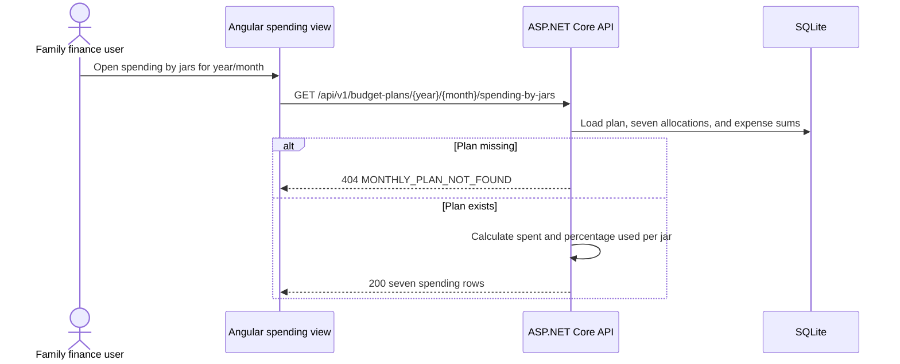

# F4 Spending by Jar - Backend Development Specification

## 1. Feature Overview

F4 provides a read-only spending summary for one existing monthly plan. The API returns all seven jars with the jar name, planned budget, spent budget, and percentage of the planned budget used.

**Requested capability:** Spending by jar summary  
**Dependency:** F1 monthly planning, F2 allocation, and F3 expenses  
**Status:** Draft; this document specifies the requested read API only.

### Scope boundary

This specification does not define F4 expense edit/delete behavior from the broader feature catalog. It defines only the requested `Spending by jars` query. The endpoint must not mutate plans or expenses and must not introduce a second spending calculation model.

## 2. Source Alignment and Visual Reference

This specification follows:

- [domain rules](../knowledge/domain.md)
- [architecture](architecture.md)
- [F3 backend contract](spec-f3-backend.md)
- the supplied Spending by jar visual reference

The visual shows a `Spending by jar` heading, an actual-spending progress bar compared with each jar's planned budget, and text in the form `spent / planned VND - percentage%`. The visual values are sample data only. The API is authoritative at runtime.

The response must include all seven canonical jars in canonical order, including jars with no expenses. A zero-spend jar returns `spentBudgetVnd: "0"` and `percentageUsed: 0`.

## 3. Business Rules and Calculations

| Rule | Backend behavior |
|---|---|
| One monthly plan per year/month | Load the plan using the required `{year}/{month}` path parameters. |
| Seven fixed jars | Return exactly seven allocations from the plan in canonical jar order. |
| Planned budget | Read the backend-calculated `BudgetVnd` from each `BudgetAllocation`. |
| Spent budget | Sum `Expenses.AmountVnd` for that allocation. Expenses from other plans are excluded through the allocation relationship. |
| Percentage used | `spentBudgetVnd / plannedBudgetVnd * 100`. |
| Over budget | Allow values above 100%; do not cap the returned percentage. |
| No expenses | Return zero spent and zero percentage used. |
| Backend authority | Calculate totals and percentage on the backend; never accept client totals. |
| Whole VND | Return planned and spent money as digit-only JSON strings. |

`plannedBudgetVnd` is always positive for a valid allocation because F1 creates positive-income plans. `percentageUsed` is a JSON number rounded to two decimal places for the response. The backend calculates using decimal arithmetic before rounding. The UI may format it as a whole percentage for the compact visual, but must not recalculate it.

Formula:

```text
percentageUsed = round((spentBudgetVnd * 100) / plannedBudgetVnd, 2)
```

Examples from the supplied visual:

- `9,000,000 / 8,750,000 = 102.86%`, displayed as `103%` if the UI uses whole-percent formatting.
- `3,200,000 / 5,000,000 = 64%`.
- `0 / 2,500,000 = 0%`.

The API returns the precise two-decimal value; the frontend controls display formatting.

## 4. Domain and Persistence Model

No new table or migration is required. Reuse the F1/F3 aggregate:

```text
BudgetPlan 1 ---- 7 BudgetAllocation 1 ---- many Expense
```

Required fields:

- `BudgetPlan.Year`, `BudgetPlan.Month`
- `BudgetAllocation.JarType`, `BudgetAllocation.BudgetVnd`
- `Expense.BudgetAllocationId`, `Expense.AmountVnd`

Do not persist `SpentVnd`, `RemainingVnd`, or `PercentageUsed`. They are derived query values and must remain correct after F3 creates or future F4 edits/deletes an expense.

## 5. API Contract

### API-F4-01 - Get spending by jars

**Method:** `GET`  
**URL:** `/api/v1/budget-plans/{year:int}/{month:int}/spending-by-jars`  
**Purpose:** Return actual spending compared with planned budget for all seven jars in the selected monthly plan.  
**Path parameters:**

| Parameter | Type | Required | Validation |
|---|---|---|---|
| `year` | integer | Yes | 1 through 9999 |
| `month` | integer | Yes | 1 through 12 |

**Query parameters:** none.  
**Request body:** none.

#### Success response: `200 OK`

```json
{
  "year": 2026,
  "month": 9,
  "currency": "VND",
  "jars": [
    {
      "jarType": "livingExpenses",
      "jarName": "Living Expenses",
      "percentageUsed": 102.86,
      "plannedBudgetVnd": "8750000",
      "spentBudgetVnd": "9000000"
    },
    {
      "jarType": "food",
      "jarName": "Food",
      "percentageUsed": 64.00,
      "plannedBudgetVnd": "5000000",
      "spentBudgetVnd": "3200000"
    },
    {
      "jarType": "emergencyFund",
      "jarName": "Emergency Fund",
      "percentageUsed": 60.00,
      "plannedBudgetVnd": "2500000",
      "spentBudgetVnd": "1500000"
    },
    {
      "jarType": "children",
      "jarName": "Children",
      "percentageUsed": 44.00,
      "plannedBudgetVnd": "2500000",
      "spentBudgetVnd": "1100000"
    },
    {
      "jarType": "savings",
      "jarName": "Savings",
      "percentageUsed": 40.00,
      "plannedBudgetVnd": "2500000",
      "spentBudgetVnd": "1000000"
    },
    {
      "jarType": "entertainmentAndTravel",
      "jarName": "Entertainment & Travel",
      "percentageUsed": 48.00,
      "plannedBudgetVnd": "1250000",
      "spentBudgetVnd": "600000"
    },
    {
      "jarType": "investment",
      "jarName": "Investment",
      "percentageUsed": 0.00,
      "plannedBudgetVnd": "2500000",
      "spentBudgetVnd": "0"
    }
  ]
}
```

The response contains exactly seven `jars`. `jarName` is the backend canonical display name. `plannedBudgetVnd` and `spentBudgetVnd` are digit-only strings. `percentageUsed` is a non-negative decimal number with a maximum of two fractional digits and may exceed 100.

#### Error responses

| HTTP | Code | Condition |
|---:|---|---|
| 400 | `VALIDATION_ERROR` | Year or month is missing/invalid/out of range |
| 404 | `MONTHLY_PLAN_NOT_FOUND` | No plan exists for the requested period |
| 500 | `INTERNAL_ERROR` | Unexpected database failure or persisted aggregate integrity failure |

Validation example:

```json
{
  "code": "VALIDATION_ERROR",
  "message": "The requested month is invalid.",
  "errors": [
    { "field": "month", "code": "OUT_OF_RANGE", "message": "Month must be between 1 and 12." }
  ]
}
```

Not-found example:

```json
{
  "code": "MONTHLY_PLAN_NOT_FOUND",
  "message": "Create a monthly plan before viewing spending by jar.",
  "errors": []
}
```

Do not return fabricated seven-jar data for a missing plan. Do not expose SQL, stack traces, or internal schema details.

## 6. DTO Contract

```csharp
public sealed record SpendingByJarsResponse(
    int Year,
    int Month,
    string Currency,
    IReadOnlyList<SpendingByJarResponse> Jars);

public sealed record SpendingByJarResponse(
    string JarType,
    string JarName,
    decimal PercentageUsed,
    string PlannedBudgetVnd,
    string SpentBudgetVnd);
```

JSON names are `year`, `month`, `currency`, `jars`, `jarType`, `jarName`, `percentageUsed`, `plannedBudgetVnd`, and `spentBudgetVnd`.

## 7. Query and Calculation Flow



Implementation guidance:

1. Validate `year` and `month` before querying.
2. Load the plan with its seven allocations and expense sums using `AsNoTracking()`.
3. Confirm the plan has exactly seven unique canonical allocations and positive planned budgets.
4. Sum `AmountVnd` by `BudgetAllocationId`, treating missing sums as zero.
5. Calculate `percentageUsed` using decimal arithmetic and round to two decimal places.
6. Order rows using the canonical jar order, not database insertion order.
7. Map to DTOs and return only the defined response fields.

A grouped query is preferred so expense totals are calculated in SQLite rather than loading every expense into memory. The query must not include expenses belonging to another allocation or plan.

## 8. Backend Tasks

- [ ] Add `SpendingByJarsResponse` and `SpendingByJarResponse` DTOs.
- [ ] Add API-F4-01 at `/api/v1/budget-plans/{year}/{month}/spending-by-jars`.
- [ ] Implement no-tracking plan/allocation query with grouped expense sums.
- [ ] Reuse canonical jar ordering and existing `Expense`/`BudgetAllocation` relationships.
- [ ] Implement decimal percentage calculation rounded to two decimal places without capping values above 100.
- [ ] Return all seven jars, including zero-spend jars.
- [ ] Map invalid periods, missing plans, and integrity failures to the defined error envelope.
- [ ] Add API sample data/verification after F3 expense migration is applied.

## 9. Database and Sample Commands

F4 read-only spending summary requires no new migration. Apply the F3 expense schema first:

```powershell
cd backend/FamilyFinance.Api
dotnet ef database update
dotnet run --urls http://localhost:5000
```

Query the endpoint:

```powershell
Invoke-RestMethod -Method Get `
  -Uri "http://localhost:5000/api/v1/budget-plans/2026/9/spending-by-jars"
```

Create sample expenses through the F3 API so the spending summary uses the normal validation and persistence path. The monthly plan must already exist.

## 10. FE/BE Field Mapping and Traceability

| UI field | Angular model | JSON property | Backend source |
|---|---|---|---|
| Selected year/month | Route parameters | `year`, `month` | `BudgetPlan.Year/Month` |
| Jar name | `jarName: string` | `jarName` | Canonical jar definition |
| Percentage used | `percentageUsed: number` | `percentageUsed` | `spentBudgetVnd / plannedBudgetVnd * 100` |
| Planned budget | `plannedBudgetVnd: string` | `plannedBudgetVnd` | `BudgetAllocation.BudgetVnd` |
| Spent budget | `spentBudgetVnd: string` | `spentBudgetVnd` | `SUM(Expense.AmountVnd)` |
| Currency | literal `VND` | `currency` | Backend constant |

| Requirement | Backend implementation |
|---|---|
| Spending by jar visual | API-F4-01 returns seven spending rows. |
| Planned budget | Read from the existing allocation. |
| Actual spending | Sum expenses linked to each allocation. |
| Percentage used | Backend decimal calculation, rounded to two decimals. |
| Over-budget display | Preserve values above 100%; do not cap. |
| Zero-spend display | Include every jar with zero spent and 0% used. |

## 11. Definition of Done and Readiness

F4 backend is complete when API-F4-01 returns all seven canonical jars for an existing `{year}/{month}` plan, including jar name, percentage used, planned budget, and spent budget; returns zero rows values correctly for jars without expenses; preserves over-budget percentages; returns the defined 404 for missing plans; and performs no data mutation.

**Backend specification:** READY for implementation design.  
**API contract:** READY for the requested read API.  
**Database migration:** NOT REQUIRED beyond F3's `Expenses` table.  
**Blocking issues:** 0 for the requested Spending by jar API.
