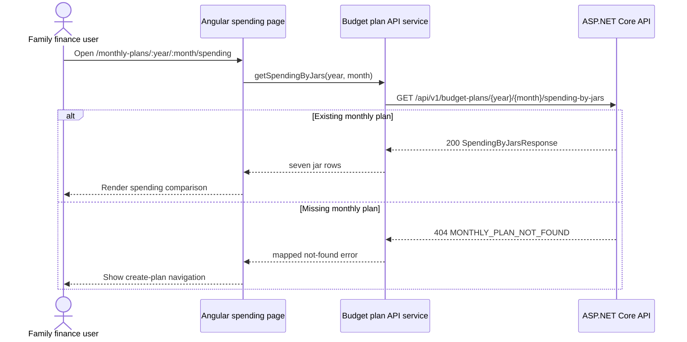

# F4 Spending by Jar - Frontend Development Specification

## 1. Feature Overview

Add a read-only Angular view that shows how much of each monthly jar budget has been spent. The page consumes the F4 backend aggregate and displays all seven jars with planned budget, spent budget, and percentage used.

**Recommended route:** `/monthly-plans/:year/:month/spending`  
**Backend API:** `GET /api/v1/budget-plans/{year}/{month}/spending-by-jars`  
**Visual reference:** supplied `Spending by jar` design

This specification covers the requested Spending by jar summary only. It does not add expense editing or deletion controls.

## 2. User Flow

1. The user opens the spending view for a selected year and month.
2. Angular reads and validates `year` and `month` from the route.
3. The page requests the F4 API.
4. While loading, the page shows a stable loading state.
5. On success, the page renders seven jar rows in the backend-provided order.
6. The user can compare actual spent budget with planned budget and percentage used.
7. If spending exceeds the planned budget, the row remains visible and the progress treatment clearly indicates over budget.
8. If no plan exists, the page shows a not-found state with navigation back to monthly planning.

## 3. Angular Models

```typescript
export interface SpendingByJarsResponse {
  year: number;
  month: number;
  currency: 'VND';
  jars: SpendingByJar[];
}

export interface SpendingByJar {
  jarType: string;
  jarName: string;
  percentageUsed: number;
  plannedBudgetVnd: string;
  spentBudgetVnd: string;
}
```

`plannedBudgetVnd` and `spentBudgetVnd` remain strings because the backend represents whole VND safely as digit-only JSON strings. The frontend may convert them only for localized display formatting. It must not use them to recalculate `percentageUsed`.

## 4. API Service Contract

Add a method to the budget plan API service:

```typescript
getSpendingByJars(year: number, month: number): Observable<SpendingByJarsResponse>;
```

The method calls:

```text
GET /api/v1/budget-plans/{year}/{month}/spending-by-jars
```

The service must:

- URL-encode or safely interpolate validated numeric route parameters;
- send no request body;
- preserve the API error envelope for the component;
- not calculate spent amounts or percentages;
- not issue one request per jar.

## 5. Page and Visual Specification

The page should follow the supplied Spending by jar visual while using the existing application shell and design tokens.

### Header

- Page heading: `Spending by jar`.
- Show the selected month and year as supporting context.
- Keep the currency context visible as `VND`.
- Provide the existing monthly-plan navigation affordance where the application shell supports it.

### Spending list

Render exactly seven rows from `response.jars`. Each row contains:

- `jarName` as the primary label;
- a progress bar showing actual spending against planned budget;
- formatted `spentBudgetVnd` and `plannedBudgetVnd` in VND;
- formatted `percentageUsed` with a `%` suffix.

The UI must use the response order. It must not sort by spending, percentage, or display name.

### Progress bar semantics

- Normal state: visual fill is proportional to `percentageUsed`, with a maximum visual width of 100%.
- Over-budget state: keep the fill at 100% maximum width, and add a distinct over-budget color/state plus the full percentage text, such as `102.86%`.
- Never hide or clamp the displayed percentage.
- Zero state: show an empty track and `0%`.
- The progress bar must have an accessible label that includes the jar name, spent amount, planned amount, and percentage.

The progress width is a display transformation only. The backend `percentageUsed` remains the source of truth.

## 6. Formatting Rules

- Format money using the existing VND formatter and no fractional digits.
- Preserve digit-only API strings until formatting; do not use floating-point arithmetic for money.
- Format `percentageUsed` with up to two fractional digits and append `%`.
- A value above 100% must remain visible, for example `102.86%`.
- Use the backend `jarName`; do not duplicate jar-name labels in frontend constants.

Example row:

```text
Living Expenses   [full over-budget track]   9,000,000 / 8,750,000 VND   102.86%
```

## 7. Component State

The page should represent these states explicitly:

| State | UI behavior |
|---|---|
| Loading | Show heading/context and a stable skeleton or loading indicator for seven rows. Disable retry until the request completes. |
| Loaded | Render all seven jars and their values. |
| Empty jars | Treat as an invalid contract/data-integrity response if `jars.length !== 7`; show a recoverable error rather than silently rendering an incomplete dashboard. |
| Missing plan | Show that no monthly plan exists for the selected period and provide the established navigation to create/view the plan. |
| Invalid route | Redirect to the existing monthly-plan route or show the standard validation state. |
| Request failure | Show the shared error state with a retry action. |

The page should avoid layout shifts by reserving stable row and progress-track dimensions during loading.

## 8. Accessibility and Responsive Behavior

- Use a semantic page heading and a list/table structure appropriate to the existing design system.
- Associate each progress bar with its jar name through an accessible label.
- Do not communicate over-budget status by color alone; include text or an accessible status such as `Over budget`.
- Keep planned and spent values readable at mobile widths without horizontal clipping.
- Stack the amount and percentage details below the bar on narrow screens if needed.
- Ensure keyboard focus remains visible for navigation and retry actions.
- Do not add decorative controls that imply editing or deleting expenses.

## 9. Frontend Implementation Tasks

- [ ] Add `SpendingByJar` and `SpendingByJarsResponse` interfaces with the exact API property names.
- [ ] Add `getSpendingByJars(year, month)` to the existing API service.
- [ ] Add the recommended `/monthly-plans/:year/:month/spending` route.
- [ ] Implement the page request lifecycle: loading, loaded, missing plan, invalid response, and retryable error.
- [ ] Render all seven backend rows without frontend reordering.
- [ ] Format VND values using existing shared formatting conventions.
- [ ] Display backend percentage values without clamping.
- [ ] Add capped visual progress width with a distinct over-budget state.
- [ ] Add accessible progress labels and responsive layout behavior.
- [ ] Use mock response data shaped exactly like the F4 DTO while backend implementation proceeds.

## 10. FE/BE Field Mapping

| UI element | Angular property | JSON property | Source/calculation |
|---|---|---|---|
| Selected year | route `year` | `year` | Monthly plan period |
| Selected month | route `month` | `month` | Monthly plan period |
| Currency | `currency` | `currency` | Backend constant `VND` |
| Jar label | `jar.jarName` | `jarName` | Backend canonical jar name |
| Planned amount | `jar.plannedBudgetVnd` | `plannedBudgetVnd` | Existing allocation budget |
| Spent amount | `jar.spentBudgetVnd` | `spentBudgetVnd` | Sum of F3 expenses |
| Percentage label | `jar.percentageUsed` | `percentageUsed` | Backend calculation |
| Progress width | derived display value | none | `min(percentageUsed, 100)` for visual width only |

## 11. API/UI Interaction



## 12. Mock Response

Frontend development can use this response before the backend endpoint is available:

```json
{
  "year": 2026,
  "month": 9,
  "currency": "VND",
  "jars": [
    {
      "jarType": "livingExpenses",
      "jarName": "Living Expenses",
      "percentageUsed": 102.86,
      "plannedBudgetVnd": "8750000",
      "spentBudgetVnd": "9000000"
    },
    {
      "jarType": "food",
      "jarName": "Food",
      "percentageUsed": 64,
      "plannedBudgetVnd": "5000000",
      "spentBudgetVnd": "3200000"
    },
    {
      "jarType": "emergencyFund",
      "jarName": "Emergency Fund",
      "percentageUsed": 60,
      "plannedBudgetVnd": "2500000",
      "spentBudgetVnd": "1500000"
    },
    {
      "jarType": "children",
      "jarName": "Children",
      "percentageUsed": 44,
      "plannedBudgetVnd": "2500000",
      "spentBudgetVnd": "1100000"
    },
    {
      "jarType": "savings",
      "jarName": "Savings",
      "percentageUsed": 40,
      "plannedBudgetVnd": "2500000",
      "spentBudgetVnd": "1000000"
    },
    {
      "jarType": "entertainmentAndTravel",
      "jarName": "Entertainment & Travel",
      "percentageUsed": 48,
      "plannedBudgetVnd": "1250000",
      "spentBudgetVnd": "600000"
    },
    {
      "jarType": "investment",
      "jarName": "Investment",
      "percentageUsed": 0,
      "plannedBudgetVnd": "2500000",
      "spentBudgetVnd": "0"
    }
  ]
}
```

## 13. Parallel Development Plan

After the API contract is frozen:

- Backend implements the aggregate query, DTO mapping, validation, and error responses.
- Frontend implements interfaces, service method, route, page states, and visual rendering using the mock response above.
- The only shared dependency is the exact JSON contract. No frontend calculation or backend UI knowledge is required.

## 14. Definition of Done and Traceability

F4 frontend is complete when the recommended route loads the F4 API, renders all seven jars, shows planned and spent VND values, displays backend-provided percentages, gives over-budget rows a clear non-color-only treatment, handles zero-spend jars and missing plans, and remains usable on mobile widths.

| Requirement | Frontend behavior |
|---|---|
| Spending by jar view | Page renders one row for each returned jar. |
| Jar name | Displays `jarName`. |
| Planned budget | Formats and displays `plannedBudgetVnd`. |
| Spent budget | Formats and displays `spentBudgetVnd`. |
| Percentage used | Displays backend `percentageUsed` with `%`. |
| Over budget | Caps only visual width; preserves percentage and status text. |
| Seven jars | Requires and renders exactly seven rows. |
| Read-only scope | No expense mutation controls are added. |

**Frontend specification:** READY for implementation.  
**FE/BE contract:** FROZEN for the requested read API.  
**Blocking issues:** 0 for the requested Spending by jar view.
